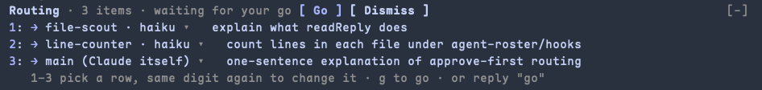

# claude-code-agent-router

A **Claude Code plugin** that lets you approve how a multi-part prompt is split across your **subagents** before any work starts, then shows each part running live.

Type a prompt with numbered items. Instead of starting right away, Claude proposes which subagent takes each item. You keep the plan or change any row, press **g**, and the agents run in parallel while a band above the prompt tracks each one.



Once you approve, the same band tracks each part:

```
Routing · 3 items · 2 running · 1 done
 1 ✓ file-scout    haiku   explain what readReply does   0:08
 2 ◐ line-counter  haiku   count lines in hooks files    0:05
 3 ● main                  one-sentence explanation      0:05
```

## Install

At the prompt of a Claude Code terminal session:

```
/plugin install agent-router --marketplace haolun1996/claude-code-agent-router
```

Answer `y` to add the marketplace, then pick a scope (user scope is the usual choice). The plugin is active at once.

From a shell:

```
claude plugin install agent-router --marketplace haolun1996/claude-code-agent-router
```

In the Claude desktop app, where `/plugin` does not run: click **+** next to the prompt box, then **Plugins**, **Add marketplace** with `haolun1996/claude-code-agent-router`, then **Add plugin**.

The routing step only starts in a project that defines subagents, in `.claude/agents/*.md` (or `~/.claude/agents/` for agents you use everywhere).

## Using it

**1. Send a prompt with numbered items**, inline (`1. … 2. …`) or one per line. Claude replies with a proposed routing and stops:

```
Proposed routing:
  1 → refactor — rename the checkout helper
  2 → backend-tests — run the suite (after 1)
  3 → me — update the changelog
```

A list of short answers to Claude's own questions (`1. yes 2. no`) is left alone.

**2. Approve or change it.**

| You do | What happens |
| --- | --- |
| `g`, or Enter on **Go** | approve the plan as shown |
| `1`–`9` in an empty prompt box | put the keyboard on that row |
| the same digit again | step into that row's dropdown; Enter opens it, ↓ Enter picks, and the keyboard moves to the next row |
| `ctrl+x tab` | give the band the keyboard (it starts on **Go**) |
| reply `go`, `proceed then`, `ok go ahead` | approve |
| reply `2 → me`, `3 → refactor` | reassign and approve |
| reply `cancel` | drop the plan |
| any other message | the plan keeps waiting |

On a wide terminal the plan opens in its own **Routing** panel with the keyboard already on it; `Esc` puts it back in the band.

**3. Watch it run.** Claude starts each agent tagged with its item number (`#2 Run the suite`), and the band shows each row running (◐), done (✓), failed (✗) or skipped (–), with timers.

### Keys while a dropdown is focused

A focused dropdown takes every key, digits and `g` included. Press Enter to pick (the keyboard then moves on to the next row's number) or Shift+Tab to step back to the row's number.

## /roster

`/roster` lists the project's subagents with their model, their purpose and how many are running. Claude reads the list too, so "run backend-tests" works right after.

By default the plugin also adds a short note to Claude's instructions naming your agents and asking it to hand matching work to them.

| Command | Effect |
| --- | --- |
| `/roster` | list the agents |
| `/roster hint off` / `on` | stop or start the delegation note |
| `/roster approve off` / `on` | numbered prompts start at once / ask for approval first |

## How it works

A Claude Code plugin made of function hooks (`hooks/register.tsx`):

- `prompt.submit` spots a numbered prompt and asks Claude for a plan; your reply approves, reassigns or cancels it (`hooks/routing.ts`).
- `turn.complete` reads the proposed plan; `agent.spawn` matches each `#n` tag to its row; agent `turn.complete`s mark rows done.
- `ui.render` draws the band above the prompt and the Routing panel.
- `prompt.compose` adds the delegation note; `/roster` reads `.claude/agents/*.md` (`hooks/roster.ts`).

Where an organization manages Claude Code, the delegation note (`prompt.compose`) does not run for a plugin you install yourself; the routing and `/roster` still do.

It depends on Claude following the plan format and the `#n` tags; when it does not, the band simply does not show, or a row shows as skipped.

## Development

```
claude plugin validate .
claude plugin test .
claude --plugin-dir .
```
